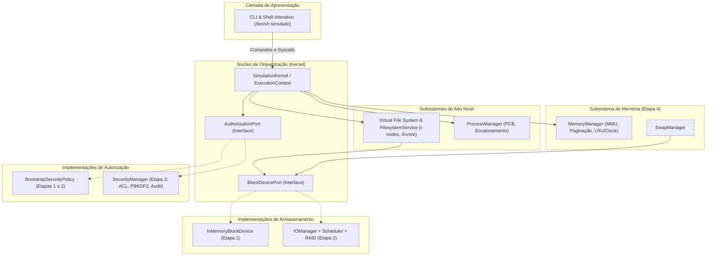
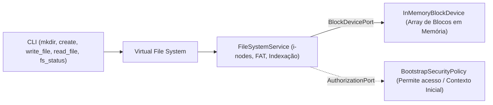
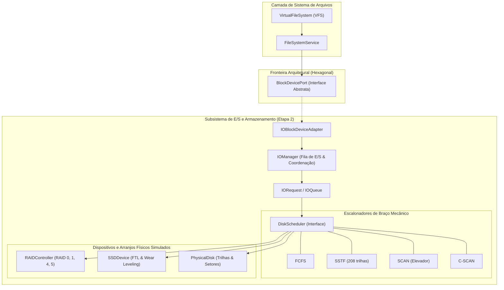
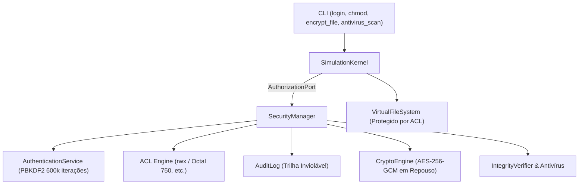
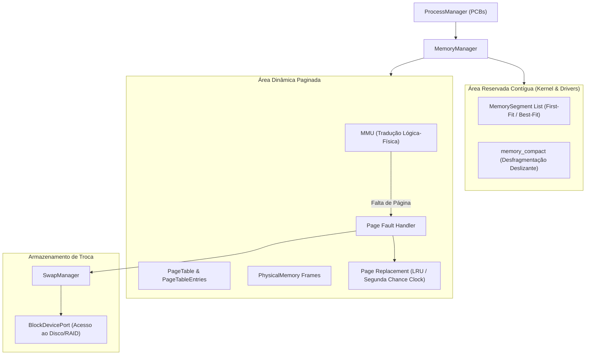
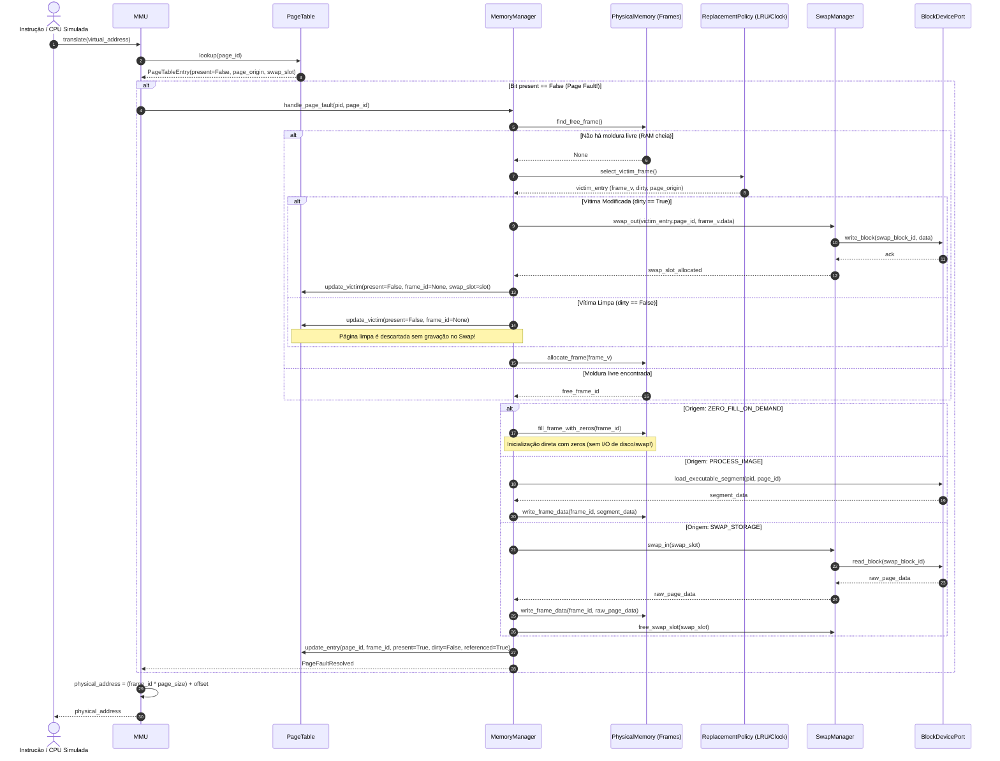

# ESPECIFICAÇÃO ARQUITETURAL DO SISTEMA — OS SIMULATOR

> **Status:** Especificação Oficial Consolidada (Fase 0.1)  
> **Objetivo:** Estabelecer a arquitetura holística, o padrão de Portas e Adaptadores (Hexagonal Architecture) para desacoplamento temporal entre etapas, fluxos de integração intersubsistemas e controle de estado do OS Simulator.

---

## 1. VISÃO ARQUITETURAL GERAL E PADRÃO DE PORTAS/ADAPTADORES

O **OS Simulator** é projetado segundo uma arquitetura modular em camadas, orientada a objetos, com baixo acoplamento e alta coesão, estruturada sob o padrão de **Portas e Adaptadores (Ports and Adapters)**. Ele reproduz os comportamentos lógicos e mecanismos internos do sistema operacional Ubuntu Linux dentro de um ambiente isolado em memória no Python 3, executado sobre o Windows 11.

### 1.1. O Desacoplamento Temporal Entre Etapas
Como o projeto é construído em quatro etapas acadêmicas consecutivas, o subsistema de Sistema de Arquivos (Etapa 1) não pode depender de implementações que ainda não foram criadas (E/S, RAID ou Segurança avançada). Para resolver isso com rigor de engenharia:
1. **Contrato de Armazenamento (`BlockDevicePort`):** Interface que define operações conceituais de leitura de bloco, gravação de bloco, consulta de capacidade, blocos livres e liberação.
   - *Na Etapa 1:* O `FileSystemService` consome o adaptador provisório em memória `InMemoryBlockDevice`.
   - *Na Etapa 2:* O subsistema `IOManager` implementa a mesma interface via `IOBlockDeviceAdapter`, incorporando a fila de requisições, o escalonador mecânico (`DiskScheduler`) e o arranjo `RAIDArray` sem que o `FileSystemService` necessite sofrer modificações estruturais.
2. **Contrato de Autorização (`AuthorizationPort`):** Interface que define verificação de permissões de leitura, escrita, execução e privilégios administrativos.
   - *Nas Etapas 1 e 2:* O Kernel utiliza o adaptador provisório `BootstrapSecurityPolicy`, que opera sob um contexto inicial de execução (`ExecutionContext`, simulando usuário `root` e permissão ampla de desenvolvimento).
   - *Na Etapa 3:* O subsistema `SecurityManager` substitui o adaptador provisório, fornecendo autenticação criptográfica (PBKDF2-HMAC-SHA256), ACLs POSIX completas e log de auditoria inviolável.

### 1.2. Propriedade dos Objetos `DiskBlock`
Para evitar redundância de dados ou ambiguidades de projeto:
- Os objetos `DiskBlock` e os buffers de dados brutos **pertencem exclusivamente à camada de armazenamento (`io` / storage abstraction)**.
- O subsistema `filesystem` manipula e armazena em seus i-nodes exclusivamente **identificadores numéricos lógicos de blocos (`block_id: int`)**. O conteúdo de um bloco só é acessado invocando `BlockDevicePort.read_block(block_id)` e `BlockDevicePort.write_block(block_id, data)`.

### 1.3. Separação de Responsabilidades: Alocação Lógica vs. Armazenamento Físico
Para manter o desacoplamento estrito exigido pela Arquitetura Hexagonal:
1. **Estado Lógico de Ocupação:** É de responsabilidade exclusiva do **Filesystem**. A tabela de i-nodes rastreia quais blocos são de dados (`allocated_blocks`) e quais são de índice (`index_block_id`). A camada de armazenamento não possui conhecimento de i-nodes, arquivos ou metadados de índice.
2. **Operações no Dispositivo:** A interface `BlockDevicePort` provê primitivas padronizadas de consulta e reserva:
   - `is_block_free(block_id: int) -> bool`: Consulta se o bloco LBA está livre no dispositivo.
   - `allocate_specific_blocks(block_ids: List[int]) -> List[int]`: Aloca blocos específicos solicitados (utilizado na alocação contígua e expansão in-place).
   - `allocate_blocks(count: int) -> List[int]` e `allocate_block() -> int`: Aloca blocos livres arbitrários.
   - `free_blocks(block_ids: List[int]) -> None` e `free_block(block_id: int) -> None`: Libera blocos de volta ao pool do dispositivo.
   - Elimina-se qualquer uso de reflexão (`hasattr`) ou acesso direto a instâncias concretas de `DiskBlock` a partir do subsistema de arquivos.
3. **Atomicidade e Transacionalidade de `write_file`:**
   - As gravações são transacionais: em caso de falta de espaço (`DiskFullException`) ou fragmentação externa (`DiskFragmentationException`), o conteúdo anterior e seus metadados permanecem 100% preservados e legíveis.
   - Em discos quase cheios, as estratégias realizam reutilização segura de blocos em disco (expansão in-place em contígua e encadeamento delta em FAT/Indexada), garantindo que arquivos existentes possam crescer consumindo apenas os blocos adicionais necessários.



---

## 2. EVOLUÇÃO ARQUITETURAL ETAPA POR ETAPA

### 2.1. Arquitetura da Etapa 1: Sistema de Arquivos Isolado
Na Etapa 1, a CLI interage com o VFS e o Filesystem. O armazenamento é gerenciado pelo adaptador `InMemoryBlockDevice`, e a segurança opera sob `BootstrapSecurityPolicy`.



---

### 2.2. Arquitetura da Etapa 2: Entrada/Saída, Escalonamento e RAID
Na Etapa 2, o adaptador provisório de armazenamento (`InMemoryBlockDevice`) é substituído pelo subsistema completo de E/S através do adaptador `IOBlockDeviceAdapter`, que implementa a porta `BlockDevicePort`. O `FileSystemService` permanece completamente agnóstico sobre RAID, SSD ou cabeçotes de disco.

Cada chamada de bloco (`read_block` / `write_block`) é traduzida em um `IORequest` com prioridade, enfileirada no `IOManager`, processada pelo algoritmo ativo de escalonamento mecânico (`DiskScheduler`) e roteada para o backend físico correspondente (`RAIDController`, `PhysicalDisk` ou `SSDDevice`).



O `IOBlockDeviceAdapter` assegura compatibilidade retroativa total: gerencia a ocupação lógica de blocos requerida pelo `FileSystemService` e delega as leituras e escritas binárias ao `IOManager`. Em arranjos RAID 1, 4 ou 5, a falha de um disco físico é absorvida de forma transparente com reconstrução *on-the-fly* via paridade XOR ou espelhamento.

---

### 2.3. Arquitetura da Etapa 3: Segurança, Controle de Acesso e Criptografia
Na Etapa 3, o `BootstrapSecurityPolicy` é substituído pelo `SecurityManager`. As chamadas ao VFS e ao Kernel agora passam por validação rigorosa de identidade e ACL, registrando auditoria. O Filesystem utiliza serviços criptográficos para dados em repouso.



---

### 2.4. Arquitetura da Etapa 4: Gerenciamento de Memória Real e Virtual com Swap
Na Etapa 4, o subsistema de processos e memória é plenamente integrado. A Área Reservada é gerenciada contiguamente (com `memory_compact`), enquanto a Área Dinâmica é paginada via MMU. O `SwapManager` utiliza diretamente a porta `BlockDevicePort` para persistir páginas em blocos simulados de armazenamento.



---

## 3. FRONTEIRAS E CONTRATOS DOS SUBSISTEMAS

### 3.1. CLI (Command Line Interface)
- **Responsabilidade:** Interpretação sintática compatível com a especificação oficial do professor (`--name`, `--size`, `--type`, `--details`, `--user`, `--key`), validação preliminar e exibição visual formatada.
- **Fronteira:** Despacha comandos ao Kernel. Não acessa blocos nem molduras diretamente.

### 3.2. Virtual File System (VFS) e Filesystem Service
- **Responsabilidade:** Resolução canônica de caminhos, hierarquia de nós (`Node`), metadados (`Inode`) e estratégias de alocação (Contígua, FAT e Indexada).
- **Fronteira:** Não instancia nem manipula discos rígidos diretamente; toda persistência é feita via `BlockDevicePort`.

### 3.3. I/O Manager, Disk Scheduler e Controladores RAID
- **Responsabilidade:** Escalonamento de cabeçote mecânico, cálculo de deslocamento de trilhas, matriz de desgaste para SSD (*Wear Leveling*), striping, espelhamento, cálculo de paridade XOR e reconstrução transparente de blocos em RAID 5.
- **Fronteira:** Expõe a interface `BlockDevicePort` para o sistema de arquivos e para o SwapManager.

### 3.4. Security Manager
- **Responsabilidade:** Autenticação robusta (PBKDF2-HMAC-SHA256 com 600.000 iterações), verificação de ACLs POSIX, diferenciação entre Modo Usuário e Modo Kernel, auditoria em `AuditLog`, criptografia AES-256-GCM de payloads e verificação de integridade/antivírus simulado.
- **Fronteira:** Atua como filtro de autorização via `AuthorizationPort`.

### 3.5. Process Manager e Memory Manager
- **Responsabilidade:** Controle de ciclo de vida de processos (PCBs), gerenciamento contíguo da Área Reservada (`memory_compact`), tabelas de páginas, molduras físicas, tradução por MMU, tratamento de Page Fault considerando origens válidas e políticas de substituição LRU e Segunda Chance.
- **Fronteira:** Utiliza `BlockDevicePort` para operações de swap-out e swap-in.

---

## 4. FLUXO DETALHADO DE PAGINAÇÃO, PAGE FAULT E SWAP

O tratamento de falta de página distingue formalmente a **origem válida** da página solicitada e o estado da página vítima:



---

## 5. ESTADO GLOBAL DA SIMULAÇÃO: O `SimulationKernel`

O contêiner central da simulação agrega as portas e subsistemas de forma unificada:

```python
class SimulationKernel:
    """Núcleo orquestrador e contêiner do estado global da simulação."""

    def __init__(self, config: SystemConfiguration):
        self.context: ExecutionContext                  # Usuário corrente, CWD, modo de privilégio
        self.auth_port: AuthorizationPort               # BootstrapSecurityPolicy -> SecurityManager
        self.block_device: BlockDevicePort              # InMemoryBlockDevice -> IOManagerAdapter
        self.vfs: VirtualFileSystem
        self.filesystem_service: FileSystemService
        self.memory_manager: Optional[MemoryManager]
        self.process_manager: Optional[ProcessManager]
        self.audit_log: Optional[AuditLog]
        self.is_running: bool

    def boot(self) -> None:
        """Inicializa os subsistemas na ordem arquitetural correta."""
        ...

    def execute_syscall(self, syscall_name: str, **kwargs) -> Any:
        """Ponto de entrada único e auditado para operações privilegiadas."""
        ...
```
