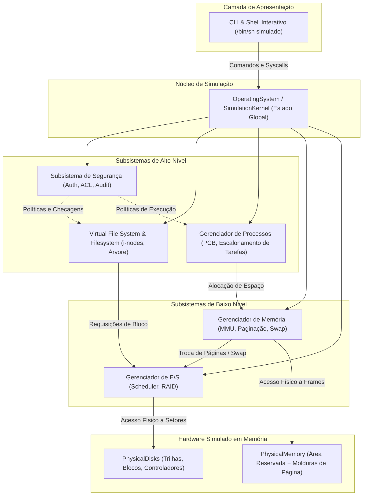
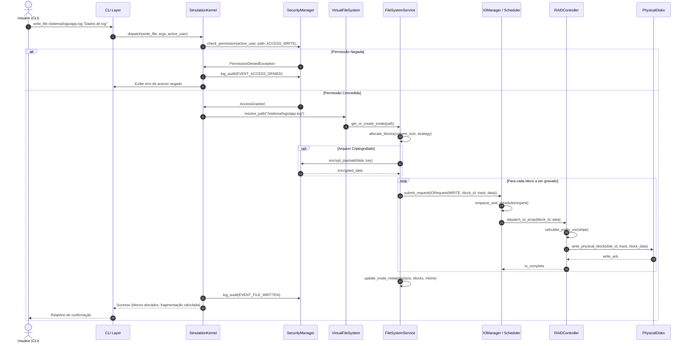
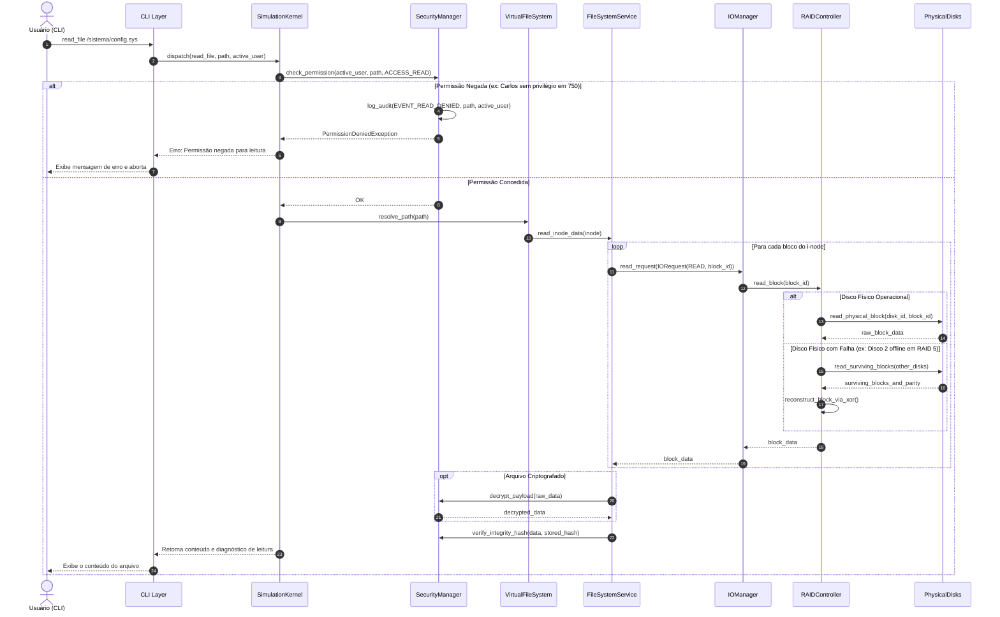
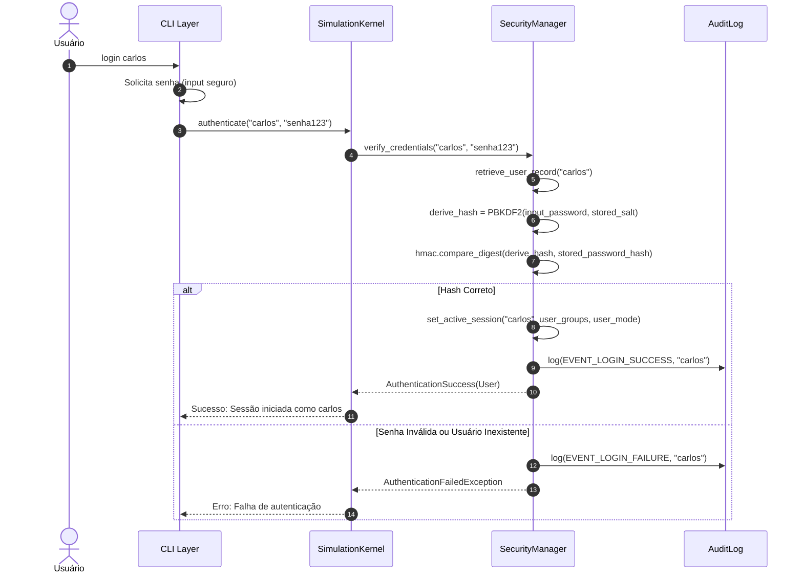
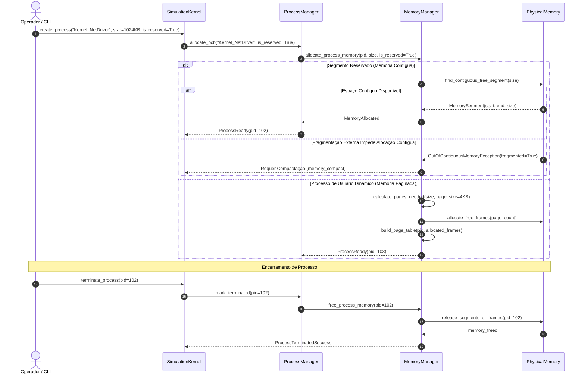
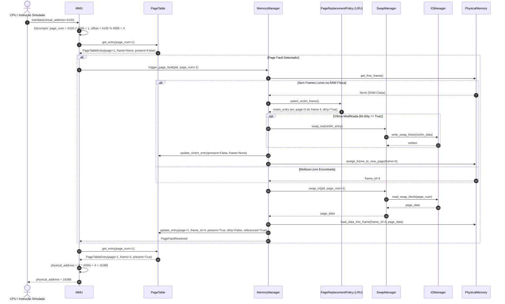

# ESPECIFICAÇÃO ARQUITETURAL DO SISTEMA — OS SIMULATOR

> **Status:** Especificação Oficial (Fase 0)  
> **Objetivo:** Estabelecer a arquitetura holística, contratos de fronteira, fluxos de integração intersubsistemas e controle de estado do OS Simulator.

---

## 1. VISÃO ARQUITETURAL GERAL

O **OS Simulator** é projetado segundo uma arquitetura modular em camadas, orientada a objetos, com baixo acoplamento e alta coesão. Ele reproduz os comportamentos lógicos e mecanismos internos do sistema operacional Ubuntu Linux dentro de um ambiente isolado em memória no Python 3, executado sobre o Windows 11.

A arquitetura organiza-se em cinco camadas lógicas:

1. **Camada de Apresentação (Interface do Usuário):** CLI e Shell Interativo simulado.
2. **Camada de Orquestração do Sistema (Kernel da Simulação):** O objeto central `OperatingSystem` (ou `SimulationKernel`), responsável por manter o estado global, mediar chamadas de sistema (syscalls) e orquestrar a cooperação entre subsistemas.
3. **Camada de Subsistemas de Alto Nível:** Segurança (`SecurityManager`), Sistema de Arquivos Virtual (`VFS` / `FileSystemService`) e Gerenciador de Processos (`ProcessManager`).
4. **Camada de Subsistemas de Baixo Nível / Gerenciamento de Recursos:** Gerenciador de Memória (`MemoryManager` com MMU e Paginador) e Gerenciador de E/S (`IOManager` com Escalonadores e Controladores RAID).
5. **Camada de Infraestrutura Física Simulada (Hardware Abstraction):** Memória Física Simulada (`PhysicalMemory` com área reservada e frames dinâmicos) e Discos Rígidos Físicos Simulados (`PhysicalDisk` com trilhas e blocos de dados).



---

## 2. FRONTEIRAS E RESPONSABILIDADES DOS SUBSISTEMAS

### 2.1. CLI (Command Line Interface)
- **Responsabilidade:** Interpretação léxica e sintática dos comandos do usuário, verificação básica de argumentos, despacho ao `SimulationKernel` e formatação visual dos resultados (tabelas, árvores, mensagens de erro).
- **Fronteira:** Não implementa regras de negócio, não aloca blocos de disco nem molduras de memória diretamente. Apenas consome as interfaces expostas pelo Kernel.

### 2.2. Virtual File System (VFS)
- **Responsabilidade:** Abstração de caminhos absolutos e relativos, normalização de caminhos (`/sistema/../logs`), resolução hierárquica a partir da raiz `/` ou do diretório corrente de trabalho (CWD), e localização de nós.
- **Fronteira:** O VFS não define o formato de alocação de blocos; ele localiza o `Node` e seu `Inode`, delegando as operações físicas de blocos ao `FileSystemService`.

### 2.3. Filesystem Service
- **Responsabilidade:** Criação, leitura, atualização e remoção de arquivos e diretórios; gerenciamento da tabela de i-nodes; cálculo de tamanho real vs. tamanho alocado; execução das estratégias de alocação (Contígua, FAT e Indexada) e métricas de fragmentação.
- **Fronteira:** Comunica-se com o subsistema de E/S para leitura e escrita de blocos. Não movimenta o braço do disco diretamente.

### 2.4. I/O Manager & Disk Scheduler
- **Responsabilidade:** Recebimento e enfileiramento de requisições de E/S (`IORequest`), execução de algoritmos de escalonamento de braço (FCFS, SSTF, SCAN, C-SCAN), cálculo de tempo de busca e distância percorrida pelo cabeçote, e controle de SSD com Wear Leveling.
- **Fronteira:** Não sabe o conteúdo semântico do arquivo; lida exclusivamente com identificadores de bloco lógico/físico, trilhas e operações de leitura/escrita.

### 2.5. RAID Controller
- **Responsabilidade:** Mapeamento de blocos lógicos do sistema de arquivos em blocos físicos de múltiplos `PhysicalDisk`. Implementa distribuição de blocos (*striping*), espelhamento (*mirroring*), cálculo de paridade XOR (RAID 4 e RAID 5) e reconstrução em caso de falha de unidade física.
- **Fronteira:** Atua como intermediário transparente entre o escalonador de E/S e os discos físicos.

### 2.6. Security Manager
- **Responsabilidade:** Autenticação de credenciais de usuários via derivação de chave segura (PBKDF2-HMAC-SHA256), gerenciamento de identidades e grupos, avaliação de matriz de controle de acesso (ACL rwx e octal), aplicação de restrições de Modo Usuário vs. Modo Kernel, registro de eventos de auditoria invioláveis, criptografia de payloads e verificação de integridade/antivírus.
- **Fronteira:** Intercepta chamadas de sistema antes da execução de operações de I/O, VFS ou processos.

### 2.7. Process Manager
- **Responsabilidade:** Criação e manutenção do ciclo de vida de processos (PCBs), transição de estados (READY, RUNNING, BLOCKED, TERMINATED), atribuição de PID e requisição de alocação de espaço ao `MemoryManager`.
- **Fronteira:** Não gerencia a tradução de endereços físicos; delega toda a infraestrutura de endereçamento e molduras à MMU e ao `MemoryManager`.

### 2.8. Memory Manager & MMU
- **Responsabilidade:** Administração da Memória Física Simulada.
  - *Área Reservada Contígua:* Alocação de processos críticos do sistema, controle de segmentos contíguos, cálculo de fragmentação externa e algoritmo de compactação `memory_compact`.
  - *Área Dinâmica Paginada:* Criação de `PageTable`, gerenciamento de `Frame`, tradução de endereços virtuais via MMU, tratamento de `PageFaultException`, execução de substituição de páginas (LRU e Segunda Chance/Clock) e comunicação com o `SwapManager`.
- **Fronteira:** Utiliza o subsistema de E/S para realizar operações de troca com a partição de Swap.

---

## 3. DIAGRAMAS DE FLUXO DE INTEGRAÇÃO

### 3.1. Fluxo de Gravação de Arquivo (`write_file`)

O fluxo demonstra a integração completa ponta a ponta desde a digitação do comando até a gravação nos discos físicos:



---

### 3.2. Fluxo de Leitura de Arquivo (`read_file`)



---

### 3.3. Fluxo de Autenticação e Autorização



---

### 3.4. Fluxo de Criação e Encerramento de Processos



---

### 3.5. Fluxo de Tradução de Endereços, Page Fault e Swap



---

## 4. GERENCIAMENTO DE DEPENDÊNCIAS ENTRE MÓDULOS

Para manter acoplamento fraco e prevenir dependências circulares:
1. **Regra de Direcionalidade:** Pacotes de alto nível podem importar tipos e interfaces de pacotes de nível inferior; o inverso é terminantemente proibido.
   - `cli` $\to$ `core`, `types`
   - `core` $\to$ `filesystem`, `io`, `security`, `memory`, `process`
   - `filesystem` $\to$ `io` (via `IOManagerInterface`), `security` (via `SecurityCheckerInterface`)
   - `memory` $\to$ `io` (para Swap via `SwapIOInterface`), `process` (apenas para referências de PID)
2. **Injeção de Dependências:** O subsistema `core.kernel.SimulationKernel` atua como agregador e injetor. Serviços como `IOManager` e `SecurityManager` são passados como dependências para o `FileSystemService` e `MemoryManager` durante a inicialização do Kernel.

---

## 5. ESTADO GLOBAL DA SIMULAÇÃO: O `SimulationKernel`

O `SimulationKernel` (ou `OperatingSystem`) é a classe singleton/container que mantém a integridade do estado global. Ele possui a seguinte responsabilidade:

```python
class SimulationKernel:
    """Contêiner central de orquestração do OS Simulator."""

    def __init__(self, config: SystemConfiguration):
        self.security_manager: SecurityManager
        self.vfs: VirtualFileSystem
        self.filesystem_service: FileSystemService
        self.io_manager: IOManager
        self.raid_controller: RAIDController
        self.memory_manager: MemoryManager
        self.process_manager: ProcessManager
        self.audit_log: AuditLog
        self.current_user: User
        self.current_working_directory: str
        self.is_running: bool

    def boot(self) -> None:
        """Inicializa todos os subsistemas em sequência segura."""
        ...

    def execute_syscall(self, syscall_name: str, **kwargs) -> Any:
        """Ponto de entrada único para chamadas privilegiadas da CLI."""
        ...
```

Esta arquitetura garante que nenhum subsistema manipule o estado de outro de forma arbitrária, mantendo toda a rastreabilidade sob o Kernel e o log de auditoria.
