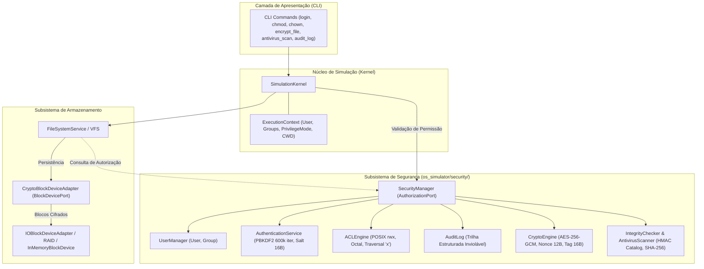
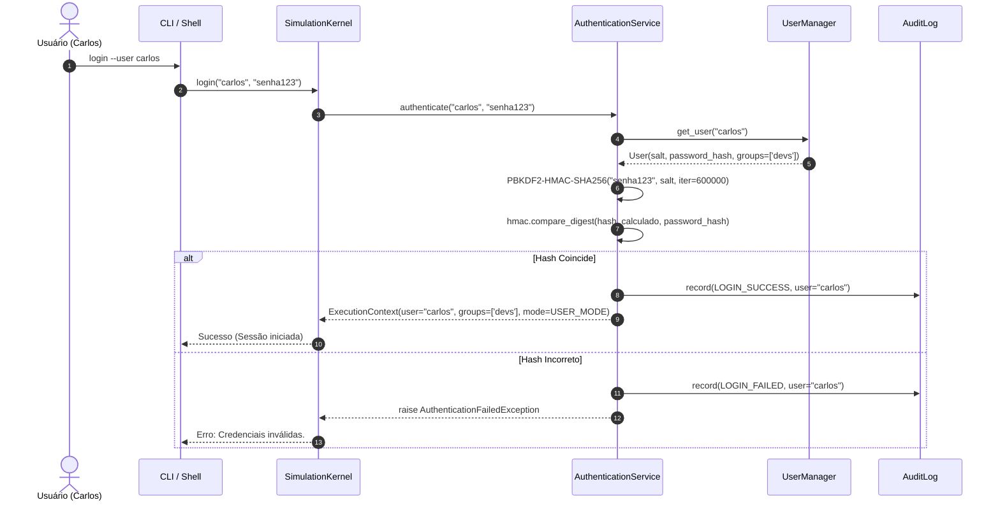
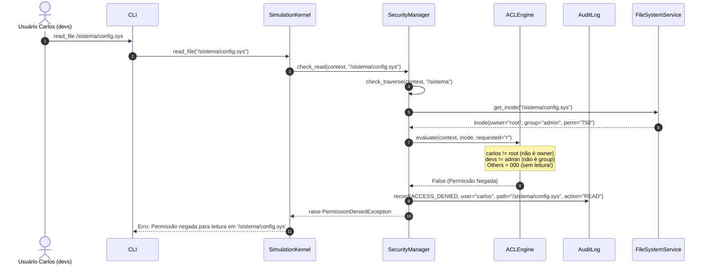
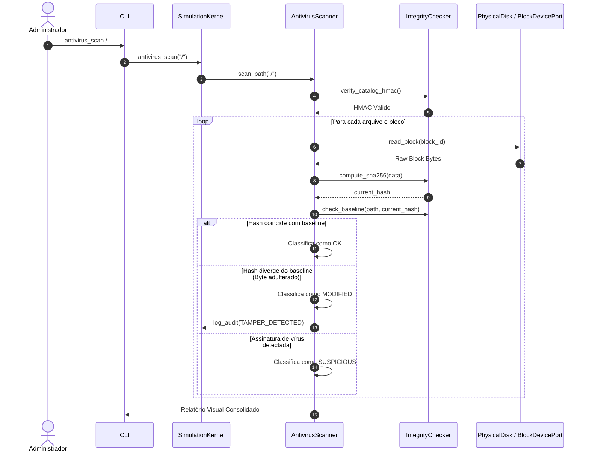

# ESPECIFICAÇÃO ARQUITETURAL DE SEGURANÇA E PROTEÇÃO (ETAPA 3) — OS SIMULATOR

> **Status:** Especificação Oficial Consolidada — Etapa 3  
> **Norma de Referência:** `AGENTS.md` e `docs/ARCHITECTURE.md`  
> **Objetivo:** Formalizar a arquitetura, contratos de integração, anéis de privilégio, controle de acesso (ACL), criptografia em repouso (AES-256-GCM), integridade com HMAC e trilha de auditoria para o subsistema de segurança do **OS Simulator**, mantendo 100% de compatibilidade retroativa com as Etapas 1 e 2.

---

## 1. VISÃO GERAL E PRINCÍPIOS DE GOVERNANÇA

O subsistema de Segurança e Proteção (Etapa 3) do **OS Simulator** introduz autenticação de usuários, autorização com controle de acesso baseado em permissões POSIX/Linux, separação estrita de privilégios (Modo Usuário vs. Modo Kernel), registro inviolável de auditoria, criptografia autenticada de blocos e arquivos em repouso, e verificação de integridade contra adulteração física e malwares simulados.

### 1.1. Princípio do Isolamento Total em Memória
Em estrita conformidade com a Seção 2 de `AGENTS.md`:
1. **Nenhuma API do Host:** É expressamente vedado o uso de chamadas de sistema do Windows 11 (`ctypes`, Win32 API, ACLs NTFS, `os.chmod` do host, etc.) ou subprocessos nativos do Ubuntu via WSL/Docker.
2. **Estruturas em Memória Python:** Usuários, grupos, senhas cifradas, tabelas ACL, trilha de auditoria e blocos de armazenamento existem unicamente em memória durante a execução do simulador.
3. **Criptografia Real:** A biblioteca `cryptography` é utilizada para fornecer cifras genuínas (AES-256-GCM) e a biblioteca padrão (`hashlib`, `hmac`, `secrets`) para derivação de chaves e assinaturas digitais em memória.

### 1.2. Padrão Arquitetural: Portas e Adaptadores (Hexagonal)
O subsistema é desacoplado do restante do sistema através de interfaces abstratas:
- **`AuthorizationPort`:** Porta abstrata consumida pelo `FileSystemService` e pelo `SimulationKernel`.
  - Nas Etapas 1 e 2: atendida por `BootstrapSecurityPolicy` (opera em contexto `root` permissivo).
  - Na Etapa 3: atendida pela implementação definitiva `SecurityManager`, aplicando ACLs, checagem de privilégios e auditoria.
- **`BlockDevicePort`:** Porta abstrata de blocos consumida pelo sistema de arquivos.
  - Na Etapa 3: decorada pelo adaptador transparente `CryptoBlockDeviceAdapter` (ou `EncryptedBlockDevicePort`), assegurando que todos os blocos gravados no backend (`InMemoryBlockDevice`, `IOBlockDeviceAdapter` ou `RAIDController`) armazenem apenas texto cifrado autenticado.



---

## 2. CONTRATOS FORMAIS DAS PORTAS DE INTEGRAÇÃO

### 2.1. Contrato `AuthorizationPort`
Definido em `os_simulator/core/ports.py`. Assegura compatibilidade com chamadas legado sem parâmetros de i-node e com chamadas de alta performance que informam o i-node resolvido.

```python
class AuthorizationPort(ABC):
    """Abstract port for security and access authorization."""

    @abstractmethod
    def check_read(self, context: ExecutionContext, path: str, inode: Optional[Any] = None) -> bool:
        """Verify read permission for resource."""
        raise NotImplementedError

    @abstractmethod
    def check_write(self, context: ExecutionContext, path: str, inode: Optional[Any] = None) -> bool:
        """Verify write permission for resource."""
        raise NotImplementedError

    @abstractmethod
    def check_execute(self, context: ExecutionContext, path: str, inode: Optional[Any] = None) -> bool:
        """Verify execute / traversal permission for resource."""
        raise NotImplementedError

    @abstractmethod
    def is_admin(self, context: ExecutionContext) -> bool:
        """Check administrative/kernel privileges."""
        raise NotImplementedError

    def check_traverse(self, context: ExecutionContext, path: str) -> bool:
        """Verify directory traversal permission along path components."""
        return True
```

#### Regras de Avaliação e Retorno:
1. **Retorno Booleano:** `check_read`, `check_write`, `check_execute` e `check_traverse` retornam `True` (acesso autorizado) ou `False` (acesso negado).
2. **Métodos de Imposição (`enforce_*`):** O `SecurityManager` provê métodos auxiliares `enforce_read`, `enforce_write`, `enforce_execute` e `enforce_traverse` que invocam as checagens correspondentes e, se `False`, levantam imediatamente `PermissionDeniedException`.
3. **Registro Obrigatório em Auditoria:** Toda recusa de acesso dispara o evento `ACCESS_DENIED` no `AuditLog` contendo usuário, grupos, caminho canônico, ação solicitada e permissões do nó.
4. **Resolução de Inode:** Se o chamador omitir `inode` (`inode is None`), o `SecurityManager` resolve o nó correspondente consultando a tabela de i-nodes via `FileSystemService` registrado.

### 2.2. Adaptador Provisório `BootstrapSecurityPolicy`
Localizado em `os_simulator/security/bootstrap.py` e reexportado por `os_simulator/core/ports.py`:
- `check_read(...) -> True`
- `check_write(...) -> True`
- `check_execute(...) -> True`
- `is_admin(...) -> context.is_root()`
- `check_traverse(...) -> True`
Garante que todas as suítes de testes unitários das Etapas 1 e 2 continuem executando sem necessidade de autenticação prévia.

---

## 3. ANÉIS DE PRIVILÉGIO E MODELO DE IDENTIDADE

### 3.1. Anéis de Execução (`PrivilegeMode`)
O simulador adota o modelo de anéis hierárquicos:
- **`PrivilegeMode.KERNEL_MODE` (`MODO_KERNEL`):**
  - Anel 0 / Modo Supervisor.
  - Acesso irrestrito a todos os nós do sistema de arquivos e comandos de administração.
  - Todas as chamadas de autorização retornam imediatamente `True`, simulando o privilégio `root` do Linux (UID 0).
  - Processos e operações críticas de sistema executam neste modo.
- **`PrivilegeMode.USER_MODE` (`MODO_USUARIO`):**
  - Anel 3 / Modo Usuário não-privilegiado.
  - Sujeito a verificação estrita de ACL em todas as operações de leitura, escrita, travessia e execução.
  - Bloqueado para comandos restritos a administradores (`useradd`, `userdel`, `groupadd`, `raid_rebuild`, formatação).
  - Elevação para `KERNEL_MODE` requer autenticação explícita como `root` ou chamada controlada de troca de contexto.

```python
class PrivilegeMode(str, Enum):
    KERNEL_MODE = "KERNEL_MODE"
    USER_MODE = "USER_MODE"

    # Aliases acadêmicos oficiais em português
    MODO_KERNEL = "KERNEL_MODE"
    MODO_USUARIO = "USER_MODE"
```

### 3.2. Contexto de Execução (`ExecutionContext`)
Localizado em `os_simulator/core/context.py`, armazena o estado volátil da sessão ativa:

| Atributo | Tipo | Descrição |
| :--- | :--- | :--- |
| `user_id` | `int` | UID numérico (0 para root, >= 1000 para usuários normais) |
| `username` | `str` | Nome de login do usuário ativo (ex.: `"root"`, `"carlos"`) |
| `groups` | `List[str]` | Lista de grupos aos quais o usuário pertence |
| `privilege_mode` | `PrivilegeMode` | Modo de execução ativo (`USER_MODE` ou `KERNEL_MODE`) |
| `cwd` | `str` | Diretório de trabalho atual canônico |

#### Métodos de Conveniência:
- `is_root() -> bool`: Retorna `True` se `user_id == 0`, `username == "root"` ou `privilege_mode == PrivilegeMode.KERNEL_MODE`.
- `primary_group -> str`: Retorna o primeiro grupo da lista ou `"users"`.
- `is_kernel_mode() -> bool`: Retorna se o anel ativo é `KERNEL_MODE`.
- `is_user_mode() -> bool`: Retorna se o anel ativo é `USER_MODE`.
- `has_group(group: str) -> bool`: Verifica pertinência ao grupo.

### 3.3. Entidades de Usuário e Grupo (`UserManager`)
Localizado em `os_simulator/security/user.py`:
- **`User` (Dataclass):**
  - `user_id: int`
  - `username: str`
  - `primary_group: str`
  - `supplementary_groups: List[str]`
  - `salt: bytes` (16 bytes gerados aleatoriamente por `secrets.token_bytes(16)`)
  - `password_hash: str` (formato hexadecimal derivado via PBKDF2)
  - `created_at: float`
- **`Group` (Dataclass):**
  - `group_id: int`
  - `name: str`
  - `members: List[str]`
- **Estado Padrão de Inicialização:**
  - Usuário `root`: `user_id = 0`, grupos `["root", "admin"]`, privilégio inicial `KERNEL_MODE`.
  - Grupos pré-configurados: `root` (GID 0), `admin` (GID 1), `users` (GID 100).

---

## 4. SERVIÇO DE AUTENTICAÇÃO (`AuthenticationService`)

Localizado em `os_simulator/security/auth.py`.

### 4.1. Derivação e Verificação Criptográfica
- **Função de Derivação:** PBKDF2 com HMAC-SHA256 (`hashlib.pbkdf2_hmac`).
- **Iterações Obrigatórias:** Exatamente **600.000 iterações**, em estrito alinhamento com a diretriz da OWASP e o Cenário `SEC-001`.
- **Salt Criptográfico:** 16 bytes exclusivos por usuário gerados via `secrets.token_bytes(16)`.
- **Comparação Segura:** `hmac.compare_digest(hash_calculado, hash_armazenado)` para prevenir ataques de temporização (*timing attacks*).

### 4.2. Mitigação de Enumeração de Usuários
- Se o usuário informado não existir no `UserManager`, o serviço realiza um cálculo PBKDF2 fictício com 600.000 iterações contra um hash simulado antes de retornar erro.
- A mensagem de erro em caso de falha deve ser genérica: `"Credenciais inválidas ou usuário inexistente."`
- É estritamente proibido exibir senhas em texto puro em exceções, consoles ou na trilha de auditoria.

### 4.3. Ciclo de Vida da Sessão
- `login(username: str, password: str) -> ExecutionContext`:
  1. Valida as credenciais.
  2. Determina o anel de privilégio: se `user_id == 0`, atribui `KERNEL_MODE`; caso contrário, atribui `USER_MODE`.
  3. Registra `LOGIN_SUCCESS` no `AuditLog`.
  4. Retorna uma nova instância de `ExecutionContext`.
  5. Se falhar, registra `LOGIN_FAILED` no `AuditLog` e levanta `AuthenticationFailedException`.
- `logout(context: ExecutionContext) -> ExecutionContext`:
  1. Registra `LOGOUT` no `AuditLog`.
  2. Redefine o contexto para uma sessão anônima restrita ou restaura o contexto padrão de sistema.

---

## 5. CONTROLE DE ACESSO POSIX E ACL ENGINE (`ACLEngine`)

Localizado em `os_simulator/security/acl.py`.

### 5.1. Modelo de Permissões POSIX
Cada i-node armazena sua máscara de permissões em formato octal ou simbólico de 3 dígitos (`Owner`, `Group`, `Others`), onde cada dígito é composto por:
- `r` (Leitura, peso 4): bit 2.
- `w` (Escrita, peso 2): bit 1.
- `x` (Execução/Travessia, peso 1): bit 0.

Exemplos de mapeamento:
- `755` $\implies$ Proprietário: `rwx` (7), Grupo: `r-x` (5), Outros: `r-x` (5).
- `750` $\implies$ Proprietário: `rwx` (7), Grupo: `r-x` (5), Outros: `---` (0).
- `644` $\implies$ Proprietário: `rw-` (6), Grupo: `r--` (4), Outros: `r--` (4).
- `600` $\implies$ Proprietário: `rw-` (6), Grupo: `---` (0), Outros: `---` (0).

### 5.2. Algoritmo Canônico de Avaliação de Permissão
Para avaliar o acesso de um `ExecutionContext` a um recurso com `Inode(owner, group, permissions)`:

```text
1. Se context.privilege_mode == KERNEL_MODE ou context.is_root():
       CONCEDER ACESSO (Root Bypass POSIX)
2. Senão se context.username == inode.owner:
       Avaliar bits de Proprietário (dígito 0 da máscara octal)
3. Senão se inode.group in context.groups:
       Avaliar bits de Grupo (dígito 1 da máscara octal)
4. Senão:
       Avaliar bits de Outros (dígito 2 da máscara octal)
```

> [!IMPORTANT]
> A avaliação segue a semântica POSIX padrão: se o usuário for o proprietário, apenas os bits de proprietário são considerados (mesmo que o grupo tenha permissões mais amplas). Se não for proprietário mas pertencer ao grupo, apenas os bits de grupo são considerados.

### 5.3. Travessia de Diretórios (*Directory Traversal*)
- Para arquivos ou subdiretórios localizados em caminhos compostos (ex.: `/sistema/logs/app.log`), o usuário deve obrigatoriamente possuir permissão `x` (execução/travessia) em **todos os diretórios ancestrais**: `/`, `/sistema` e `/sistema/logs`.
- A falta do bit `x` em qualquer diretório intermediário interrompe imediatamente a resolução com `PermissionDeniedException` e gera `ACCESS_DENIED` na auditoria.

### 5.4. Modificação de Permissões e Propriedade
- `chmod <modo> <caminho>`: Apenas o `root` ou o proprietário do arquivo podem alterar permissões.
- `chown <usuario>[:<grupo>] <caminho>`: Apenas o usuário `root` (`KERNEL_MODE`) possui autorização para transferir a propriedade de arquivos ou diretórios.

---

## 6. LOG DE AUDITORIA INVIOLÁVEL (`AuditLog`)

Localizado em `os_simulator/security/audit.py`.

### 6.1. Estrutura de `AuditEvent`
```python
@dataclass
class AuditEvent:
    timestamp: float
    event_type: AuditEventType
    username: str
    path: Optional[str]
    action: str
    result: str  # "SUCCESS" ou "FAILURE"
    details: Dict[str, Any]
```

### 6.2. Eventos Rastreados (`AuditEventType`)
- `ACCESS_GRANTED`: Acesso autorizado a arquivos sensíveis ou recursos protegidos.
- `ACCESS_DENIED`: Tentativa de acesso bloqueada por falta de permissão na ACL.
- `LOGIN_SUCCESS`: Sessão iniciada com sucesso.
- `LOGIN_FAILED`: Tentativa de autenticação falhou.
- `LOGOUT`: Encerramento de sessão.
- `PRIVILEGE_ELEVATION`: Transição para `KERNEL_MODE`.
- `PERMISSION_CHANGED`: Execução de comando `chmod`.
- `OWNERSHIP_CHANGED`: Execução de comando `chown`.
- `USER_MANAGEMENT`: Criação ou remoção de usuário/grupo.
- `TAMPER_DETECTED`: Adulteração física ou divergência de integridade detectada.
- `CRYPTO_OPERATION`: Criptografia ou descriptografia de arquivo/bloco.

### 6.3. Imutabilidade e Consulta
- A lista de eventos é mantida em memória de forma *append-only*.
- Provê métodos de consulta: `get_recent(limit=50)`, `filter_by_type(event_type)`, `filter_by_user(username)`.
- Provê formatador textual oficial compatível com os relatórios exigidos na CLI.

---

## 7. CRIPTOGRAFIA EM REPOUSO E ADAPTADORES DE ARMAZENAMENTO

Localizado em `os_simulator/security/crypto.py`.

### 7.1. Parâmetros Criptográficos
- **Cifra Simétrica:** AES-256 no modo Galois/Counter Mode (AES-256-GCM) via `cryptography.hazmat.primitives.ciphers.aead.AESGCM`.
- **Chave:** 256 bits (32 bytes), gerada via PBKDF2 ou fornecida diretamente pelo `KeyManager`.
- **Nonce (IV):** Exatamente 12 bytes gerados aleatoriamente por bloco/arquivo via `secrets.token_bytes(12)`. O nonce **nunca** é reutilizado para a mesma chave.
- **Tag de Autenticação:** 16 bytes produzidos pelo AESGCM, assegurando confidencialidade e autenticidade.

### 7.2. Empacotamento de Payload Cifrado
O payload gravado no armazenamento secundário segue a estrutura padronizada:
```text
+-----------------------+-----------------------------+------------------------+
| Nonce (12 bytes)      | Ciphertext (N bytes)        | Auth Tag (16 bytes)    |
+-----------------------+-----------------------------+------------------------+
```
Qualquer alteração em um único byte do ciphertext, nonce ou tag resulta em rejeição imediata na descriptografia com `DecryptionFailedException`.

### 7.3. Níveis de Criptografia Integrados

#### Nível A: Adaptador de Bloco Transparente (`CryptoBlockDeviceAdapter`)
Implementa `BlockDevicePort` decorando qualquer dispositivo subjacente (`InMemoryBlockDevice`, `IOBlockDeviceAdapter` ou `RAIDController`):
- `write_block(block_id, data)`: Cifra os dados com AES-256-GCM gerando novo nonce e grava o payload cifrado no backend.
- `read_block(block_id)`: Lê o payload cifrado do backend, autentica a tag e decifra os dados com AES-256-GCM.
- Todas as operações de alocação e liberação são transparentemente delegadas ao dispositivo embrulhado.

#### Nível B: Criptografia a Nível de Arquivo (`encrypt_file` / `decrypt_file`)
- Atua diretamente no `FileSystemService` e nos nós da árvore VFS:
  - `encrypt_file(path, key)`: Lê o conteúdo original, cifra com AES-256-GCM, grava os blocos cifrados, atualiza `inode.file_size` e marca `inode.is_encrypted = True`.
  - `decrypt_file(path, key)`: Valida permissão, lê os blocos cifrados, decifra e valida a integridade com AES-256-GCM, regrava o texto plano e marca `inode.is_encrypted = False`.

---

## 8. INTEGRIDADE DE DADOS E ANTIVÍRUS SIMULADO

Localizado em `os_simulator/security/integrity.py`.

### 8.1. Catálogo Base Assinado (`BaselineCatalog`)
- Mantém o registro oficial de hashes SHA-256 de todos os arquivos e blocos críticos do sistema.
- **Proteção por HMAC do Kernel:** O catálogo inteiro é assinado digitalmente usando HMAC-SHA256 (`hmac.new(kernel_secret, catalog_bytes, hashlib.sha256)`).
- Qualquer modificação indevida no catálogo sem a chave mestra do Kernel invalida a assinatura HMAC, alertando violação catastrófica de integridade.

### 8.2. Scanner de Antivírus e Detecção de Adulteração (`AntivirusScanner`)
O scanner executa varredura recursiva a partir de um caminho base (`antivirus_scan <caminho>`) e categoriza cada arquivo encontrado em:
- **`OK`:** O conteúdo do arquivo coincide rigorosamente com o hash registrado no catálogo de integridade e não contém assinaturas suspeitas.
- **`OK_ENCRYPTED`:** Arquivo cifrado de forma legítima, com tag de autenticação válida e integridade preservada.
- **`MODIFIED`:** O hash do arquivo ou de seus blocos diverge do catálogo de integridade oficial (adulteração deliberada ou corrupção de dados).
- **`SUSPICIOUS`:** O arquivo contém uma sequência de bytes correspondente a assinaturas educacionais de malware simuladas.
- **`INACCESSIBLE`:** O usuário que disparou a varredura não possui permissão de leitura ou travessia para inspecionar o arquivo.

#### Base de Assinaturas Educacionais de Teste:
```python
SIMULATED_MALWARE_SIGNATURES = {
    "SIM_MALWARE_TROJAN_PAYLOAD": "Trojan.Simulator.Generic",
    "SIM_MALWARE_VIRUS_SIG_01": "Virus.Academic.BlockTamper",
    "SIM_RANSOM_SAMPLE_TEST": "Ransom.Simulator.LockTest",
}
```

---

## 9. DIAGRAMAS DE SEQUÊNCIA E FLUXOS DE INTEGRAÇÃO

### 9.1. Cenário SEC-001: Autenticação Criptográfica com PBKDF2 e Salt


### 9.2. Cenário SEC-002: Fiscalização de ACL e Negação de Acesso com Auditoria


### 9.3. Cenário SEC-003: Integridade, HMAC e Detecção de Adulteração


---

## 10. ESTRUTURA MODULAR DO PACOTE `os_simulator/security/`

```text
os_simulator/security/
├── __init__.py           # Reexportações públicas, enums e constantes
├── bootstrap.py          # BootstrapSecurityPolicy (adaptador provisório das Etapas 1 e 2)
├── user.py               # User, Group, UserManager
├── auth.py               # AuthenticationService (PBKDF2 600k iterações, salt 16B)
├── acl.py                # ACLEngine, POSIX rwx, máscaras octais, travessia 'x'
├── audit.py              # AuditEvent, AuditLog, formatação de relatórios
├── crypto.py             # CryptoEngine (AES-256-GCM), CryptoBlockDeviceAdapter
├── integrity.py          # BaselineCatalog (HMAC), IntegrityChecker, AntivirusScanner
└── service.py            # SecurityManager (implementação completa de AuthorizationPort)
```

### 10.1. Distribuição de Responsabilidade por Agente
- **Agente 1 (`@architect`):** Arquitetura geral, formalização de contratos, alinhamento de `context.py`, `ports.py`, `types.py`, `exceptions.py` e documentação mestre em `docs/SECURITY_ARCHITECTURE.md`.
- **Agente 2 (`@identity`):** `user.py`, `auth.py`, `UserManager`, `AuthenticationService`, PBKDF2 com 600k iterações e gestão de transição de anéis de privilégio.
- **Agente 3 (`@acl`):** `acl.py`, `audit.py`, `service.py`, `ACLEngine`, `AuditLog`, `SecurityManager`.
- **Agente 4 (`@crypto`):** `crypto.py`, AES-256-GCM, empacotamento de payload, `CryptoBlockDeviceAdapter` para transparência em blocos e funções de cifra em arquivos.
- **Agente 5 (`@integrity`):** `integrity.py`, catálogo base protegido por HMAC, verificador SHA-256 e `AntivirusScanner`.
- **Agente 6 (`@verifier`):** Revisão independente de código, testes de integração ponta a ponta (`tests/test_security_integration.py`) e validação da matriz `GROUND_TRUTH.md`.

---

## 11. COMANDOS DA CLI E FORMATOS VISUAIS EXIGIDOS

| Comando | Sintaxe | Privilégio Mínimo | Descrição |
| :--- | :--- | :--- | :--- |
| `login` | `login --user <nome> [--password <senha>]` | Qualquer | Inicia sessão com verificação PBKDF2 |
| `logout` | `logout` | Qualquer | Encerra sessão ativa |
| `whoami` | `whoami` | Qualquer | Exibe usuário ativo, grupos e anel de privilégio |
| `useradd` | `useradd <nome> [--group <grp>] [--groups <g1,g2>]` | `KERNEL_MODE` | Cria novo usuário com salt individual |
| `userdel` | `userdel <nome>` | `KERNEL_MODE` | Remove usuário existente |
| `groupadd` | `groupadd <nome>` | `KERNEL_MODE` | Registra novo grupo no sistema |
| `chmod` | `chmod <modo_octal> <caminho>` | Owner / `root` | Altera permissões rwx (ex.: `chmod 750 /dir`) |
| `chown` | `chown <dono>[:<grupo>] <caminho>` | `KERNEL_MODE` | Transfere propriedade de arquivo ou diretório |
| `encrypt_file` | `encrypt_file <caminho> [--key <chave>]` | Owner / `root` | Aplica cifra AES-256-GCM autenticada no arquivo |
| `decrypt_file` | `decrypt_file <caminho> [--key <chave>]` | Owner / `root` | Decifra arquivo autenticando tag AES-256-GCM |
| `antivirus_scan`| `antivirus_scan [<caminho>]` | Qualquer | Executa varredura de integridade e assinaturas |
| `audit_log` | `audit_log [--limit <n>] [--user <u>] [--type <t>]`| `KERNEL_MODE` | Exibe a trilha de auditoria do sistema |

---

## 12. MATRIZ DE TESTES E CRITÉRIOS DE ACEITAÇÃO

A implementação da Etapa 3 é considerada aprovada se, e somente se:
1. **SEC-001:** O teste de login com PBKDF2 valida exatamente 600.000 iterações, rejeita senhas incorretas em tempo constante e gera registro no `AuditLog`.
2. **SEC-002:** Arquivo `/sistema/config.sys` com permissão `750 root:admin` bloqueia rigorosamente a leitura do usuário `carlos` (`devs`), levantando `PermissionDeniedException` e registrando `ACCESS_DENIED`.
3. **SEC-003:** Adulteração de 1 byte em qualquer bloco gravado é detectada imediatamente tanto na decifração AES-256-GCM (falha de tag) quanto no `antivirus_scan` (divergência contra `BaselineCatalog`).
4. **Regressão Zero:** 100% dos 80 testes das Etapas 1 e 2 continuam passando sem qualquer modificação de código que viole seus contratos.
